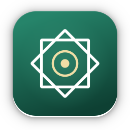
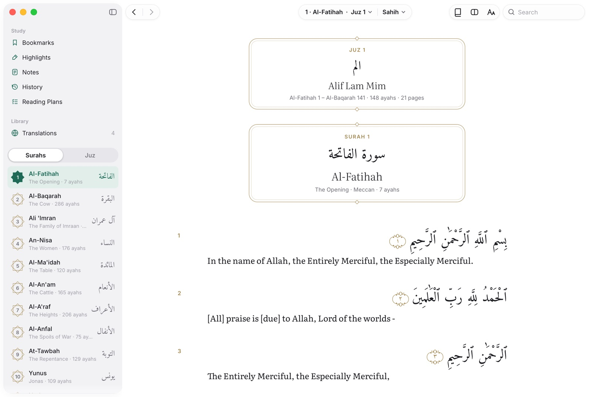
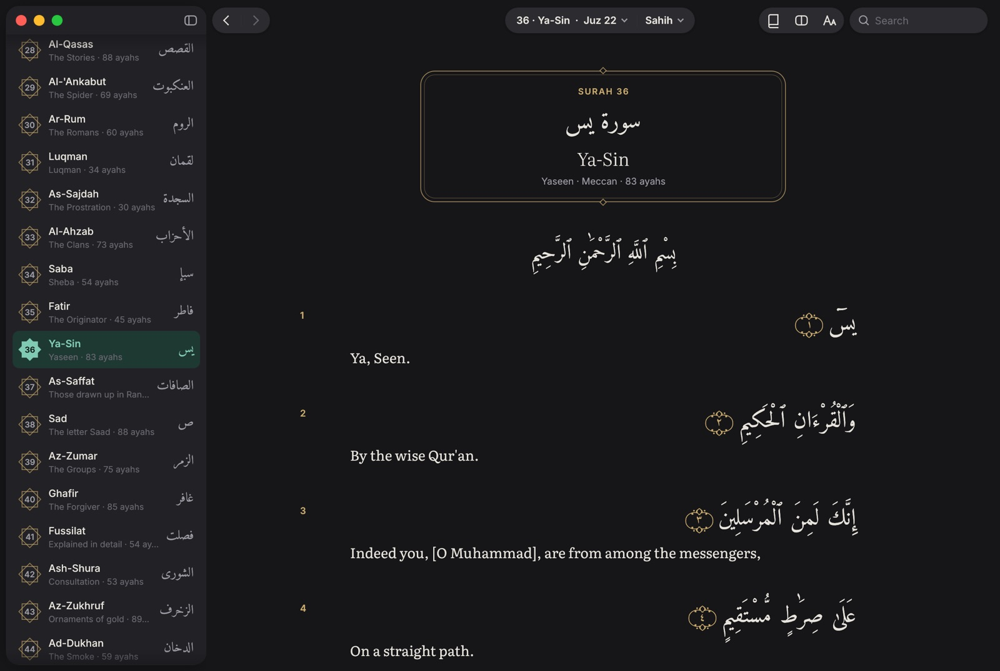
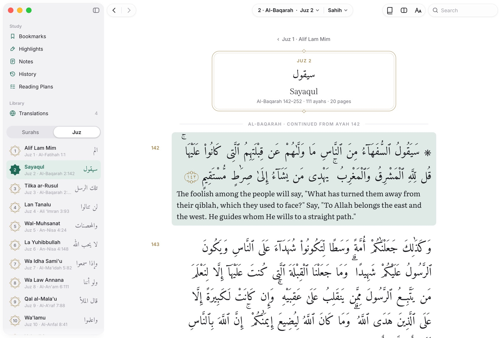
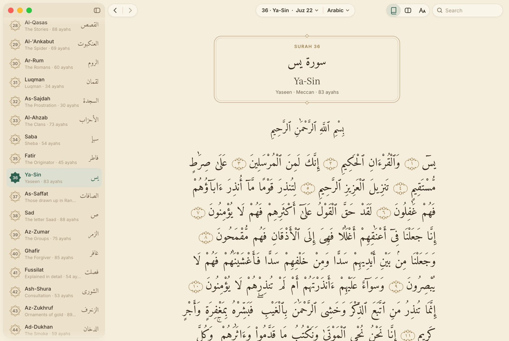
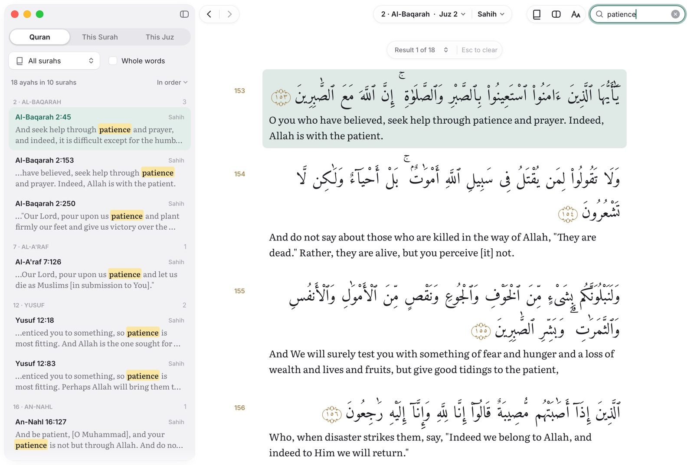
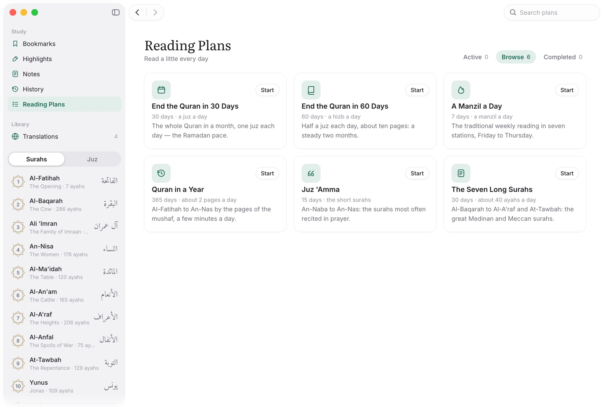

<p align="center"></p>

<h1 align="center">Quran</h1>

<p align="center">
A fast, native Quran reader for the Mac, written in Rust: the Uthmani text beautifully typeset,
read by <b>surah</b> or by <b>juz</b>, with translations beneath each ayah, instant search in Arabic and
English, and highlights, notes, bookmarks, reading history and plans kept on your computer.
</p>

<p align="center">
<a href="https://github.com/thezeeshann/quran/releases/latest/download/Quran.dmg"><b>Download for Mac</b></a>
· Apple Silicon and Intel · macOS 11 or later · Free
</p>



## Download

Get **Quran.dmg** from the [latest release](https://github.com/thezeeshann/quran/releases/latest),
open it and drag **Quran** into **Applications**. The app isn't notarized by Apple yet, so the
first time you open it macOS says it can't verify the developer: click **Done**, then open
**System Settings → Privacy & Security**, click **Open Anyway** next to Quran and confirm. You
only do this once.

## Screenshots

| | |
|---|---|
|  |  |
| **Translation view**, light — the juz card and surah heading | **Dark theme** |
|  |  |
| **Juz by name** — a juz at a time, with its details | **Reading view**, sepia — the Arabic alone, like a mushaf |
|  |  |
| **Search** as you type, matches highlighted | **Reading plans** |

It is a reconstruction of [bible-rs](https://github.com/michaelshimeles/bible-rs) (MIT) for the
Quran: the same architecture (egui 0.36 on Metal, a virtualized reader, a local SQLite
study store) and the same features, with the Bible's model replaced by the Quran's.

## Features

**Reading**
- One **juz at a time**: each juz is its own page, opening with its card and ending with
  "End of Juz" and a **Continue to Juz N** button (jumping anywhere opens the juz it lies in).
  Typeset a section (ruku) at a time — only what is on screen is ever laid out.
- The Arabic in **Amiri Quran**, shaped by HarfRust (a Rust HarfBuzz) and set right to left word
  by word: joined letters, harakat and Quranic pause marks placed by the font, lines filled from
  the right, each ayah closed by its ornament (۝) with its number in Arabic-Indic digits.
- Two views (⌘L): **Translation** — each ayah, then its transliteration and one or more
  translations — and **Reading** — the Arabic alone, flowing like a mushaf page, optionally
  justified.
- Surah headings (Arabic name, transliteration, meaning, Meccan/Medinan, ayah count) with the
  Basmala; each juz opens with a **juz card** (its Arabic name, transliteration, span, ayahs
  and pages); hizb quarters and sajdas in the margin.
- Separate Arabic and translation sizes and line spacing, line length, light / sepia / dark
  themes (⌘⇧L), five accent colours, focus mode (⌃⌘F) with reading progress. Remembers where you were.

**Navigation — surah and juz**
- Sidebar with a **Surahs | Juz** switch: 114 surahs (number in an eight-pointed star, Arabic
  name, meaning, ayah count) or the 30 juz (by name — Alif Lam Mim, Sayaqul… — in Arabic and
  transliteration, with where each starts).
- The toolbar's surah picker: a grid of surahs or juz, and any surah's ayahs.
- ⌘K jumps anywhere: `2:255`, `baqarah 255`, `yaseen`, `al-kahf 10`, `the cow`, `البقرة ٢٥٥`,
  `juz 30`, `juz amma`, `page 50`, `hizb 12` — common spellings and typos included.
- ← → previous/next surah, ⇧← ⇧→ previous/next juz, ⌘[ ⌘] back and forward.

**Search** (⌘F)
- As you type, in the translation — or in the **Arabic** when you type Arabic (harakat, alef
  forms, taa marbuta and attached particles folded: `الصبر` finds `بِٱلصَّبْرِ`).
- `"exact phrase"`, `-excluded`, whole words; the whole Quran, this surah or this juz; matches
  highlighted, ↑ ↓ ⏎ to step through them, "Did you mean" for misspellings.

**Study**
- Click an ayah (⇧-click for a range, J/K to move), then highlight in six colours (1–6, 0 clears),
  write a note (N), bookmark (B / ⌘D), copy the Arabic (⌘C) or with translation (⇧⌘C), compare
  translations (C), share as an image. Right-click opens the ayah menu.
- Pages for Bookmarks, Highlights, Notes (Markdown, linked ayahs), History and Reading Plans
  (the whole Quran in 30 or 60 days, a manzil a day, the Quran in a year, Juz 'Amma, the seven long surahs).
- Export to Markdown (⌘E) or JSON (⌘⇧E); JSON imports back; automatic daily backups.

**Translations**
- Built in: Saheeh International, Pickthall, Yusuf Ali, the transliteration, and Jalandhry's
  Urdu (set right to left in Noto Naskh Arabic).
- **Get More**: the Tanzil Project's catalogue of 118 translations in about 45 languages, one
  click each, kept offline afterwards. Or import a file in Tanzil's `sura|aya|text` format.
- ⌘1…⌘9 switch; ⇧⌘P shows more translations under each ayah; Compare shows one ayah in all.

**Mac**
- Native menu bar, unified title bar, Metal rendering on the low-power GPU, app icon,
  `scripts/bundle-macos.sh` → `dist/Quran.app` (+ `DMG=1` → `dist/Quran.dmg`).

## Build from source

```sh
cargo run --release -p quran-rs           # the app (the crate and command are named quran-rs)
scripts/bundle-macos.sh                   # dist/Quran.app (UNIVERSAL=1, DMG=1, SIGN_IDENTITY=…)
cargo test --workspace
```

The command line works without a window:

```sh
quran-rs read "2:255" [--translation en.pickthall]
quran-rs search "patience" [--surah 2 | --juz 30]
quran-rs search "الصبر"
quran-rs list | catalog | download en.asad | import file.txt | remove <id>
quran-rs export --markdown -o notes.md
```

Data lives in `~/Library/Application Support/quran-rs/` (`QURAN_RS_HOME` overrides it).

## Releasing

```sh
# 1. Bump `version` in Cargo.toml, then build the universal app and disk image.
UNIVERSAL=1 DMG=1 scripts/bundle-macos.sh             # dist/Quran.dmg
# 2. Tag and publish; the asset must be named Quran.dmg for the download links.
gh release create v0.1.0 dist/Quran.dmg --title "Quran 0.1.0" --notes "First release"
```

The website and README link to `releases/latest/download/Quran.dmg`, so they always serve the
newest release. Update the version shown in `site/index.html` when you release.

## Layout

| | |
|---|---|
| `crates/core` | Quran text and structure (surahs, ayahs, juz, hizb, rukus, pages, sajdas), translations and their library, the catalogue, search, reference parsing, plans, the SQLite study store. No GUI. |
| `crates/app` | The egui app: reader and its right-to-left layout, sidebar, surah picker, palette, popovers, pages, settings, onboarding, macOS chrome, CLI. |
| `site` | The download page (static HTML for Vercel; `/download` redirects to the latest DMG). |
| `xtask` | `cargo run -p xtask -- build-data` rebuilds `data/` from Tanzil's files (digests pinned). |
| `crates/app/examples/shot.rs` | Renders the app offscreen to a PNG (`QURAN_RS_DEMO="jump:2:255;compare:2:255"`). |

## Sources and licences

- **Quran text**: Tanzil Uthmani 1.1, © Tanzil Project, CC BY 3.0 — included verbatim (the
  Basmala opening each surah is shown as its heading, the text itself is unchanged), with its
  notice in `data/quran/NOTICE.txt`. Metadata: Tanzil `quran-data.xml`.
- **Translations**: from the Tanzil Project's collection, for non-commercial use under their own
  terms; each one's notice is shown on the Translations page.
- **Fonts**: Amiri Quran and Amiri (Khaled Hosny), Noto Naskh Arabic, Literata and Inter — all
  SIL Open Font License 1.1.
- **Code**: MIT. Portions derived from bible-rs, © 2026 Micky, MIT.
